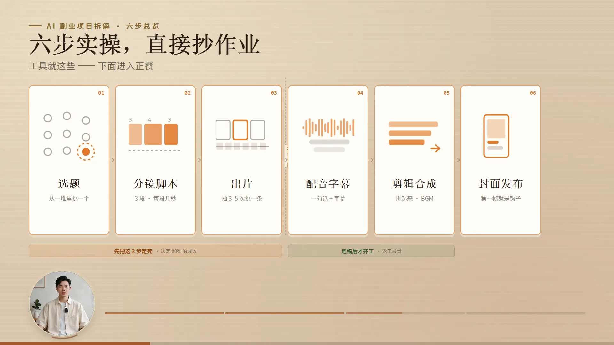
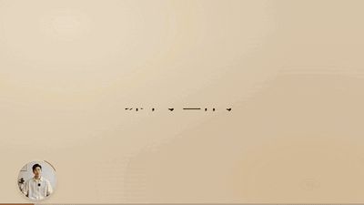

# voice-to-deck · 口播转动态演示页

[](https://skills.sh)
[](LICENSE)
[](#验证)

[English](README.en.md) · **中文**

> 把一条**完整 MP3** 当作时间轴，做出一套 1920×1080 的动态 PPT 网页：页、拍、进度条全部跟着媒体走。支持两档模式——**静音档**（MP3 只当时钟不出声，录屏后合轨）和**有声档**（出声的那条媒体自己当时钟，双击就有声音）。
>
> 核心规则只有一条：**时钟必须等于声源。** 出声的是谁，就用谁的 `currentTime`。音画对不上，十次有九次是这条被违背了。

装这一个目录就够了。不依赖任何其它 Skill，主题库已内置。


*上面是真实产物**从第 0 秒开始**的 24 秒录屏（19 页 / 385 秒的项目，牛皮纸主题）——标题落笔 → 卡片一张张出现 → 翻页 → 第二页四个分镜镜头。刻意从 0 开始并跨页，因为只有这样才能同时看到「元素怎么长出来」和「页怎么跟着音轨换」。*

---

## 你什么时候需要它

1. 你已经有一条配好音的口播 MP3（或会配），想做一条讲解型动态 PPT，但不想让字幕出现在画面里。
2. 你有现成的 PDF / Word / 文章 / 截图，需要先归一化成素材，再按口播顺序排成页。
3. 你有一条长片（300 秒以上），怕「页切错、音画对不上」，需要能把每个页边界和每句话都核一遍的做法。

## 它会交付什么

- 一个 1920×1080 的 Vite + React + TypeScript 工程，**时钟元素**的 `currentTime` 是唯一时间源
- `timeline.json`（页/拍/句的时间表）、`outline.md`、`ppt-focus.md`、`cover-brief.md`
- `visual-direction.md`（选定的主题 id 与三个设计旋钮）、`source-map.md`、`assets-manifest.json`、`input-report.json`
- `review-report.md` + `review-results.json`（逐项带证据的验收记录）
- 固定录制 URL + 一键启动脚本

## 快速开始

**拿到 zip 或文件夹（最常见）：** 解压后把整个 `voice-to-deck/` 目录放进 skills 目录，就这样。

```
~/.workbuddy/skills/voice-to-deck/
~/.claude/skills/voice-to-deck/
```

放好之后直接说：

> 用 voice-to-deck，把这条口播做成动态 PPT。MP3 和 SRT 在 xxx。

自检（在包目录下执行，应为 `PASS` 且 `themeCount: 23`）：

```bash
node scripts/list-themes.mjs
```

**如果这个包已经在 GitHub 上**，也可以一行装：

```bash
npx skills add Rodegrs-lin/voice-to-deck --skill voice-to-deck
```

## 触发方式

按「你手上有什么 / 你想解决什么」分三类，原话照说就行。完整自测清单（13 条，含每条应该发生什么、怎么判断做对了）在 `test-prompts.json`。

**有素材，想开工**

- 「我有一条口播 MP3 和字幕，帮我做成动态 PPT」
- 「这是素材，MP3、SRT、还有几篇文章，你先看看能做成啥」
- 「想做一条 5 分钟的讲解片，配音已经好了」

**声音拿不准**（这一组最容易出问题，建议先看 `CLOCK-AND-SYNC.md`）

- 「网页要有声音，我发给客户直接看就行」
- 「我要录屏投稿，网页别出声」
- 「画面和声音对不上，声音出来了画面还没动」

**选型与排查**

- 「给我几个风格让我选」
- 「数字人要放在左下角圆形，跟正文对齐」
- 「只有中间那几页对不上，前面是对的」
- 「双击打开是黑屏」
- 「页面上把字幕烧上去」

## 成品长什么样

下面三张是真实产物截图（AI 副业项目拆解，19 页 / 385 秒，牛皮纸主题），不是示意图：


封面这一页同时满足三件事：有**实物锚点**（左边手机界面是真实截图）、有**量在推移**（30 个人头 = 1 万人，条状图按赞数排）、有**唯一主角**（左下角数字人圆形画中画）。




第三张是数据页。柱子在长、标注在落、底部有页内进度线——**画面一直在动，但没有一句话配一个新图案**。这就是这个包和动效片的分界。

再看一段动起来的。同一份产物的另一页，口播在讲「踩中了三件事」：



三张图按顺序落位，**编号先出现、图后到**——动图里能抓到「第 3 张还是虚线占位、编号 ③ 已经在了」的那一瞬。这就是「每拍都有一次可见变化」的样子：不是三张同时淡入，而是每一拍都有东西在长。

## 它和同类工具的不同

| | 一般「AI 做 PPT」 | 本包 |
|---|---|---|
| 时钟 | 每页定时 auto-advance | **时钟等于声源**；静音档用 MP3、有声档用发声元素，漂移超 0.3s 自动跟随校正 |
| 音轨 | 页面内播放/静音开关 | 两档明确二选一，写进 `timeline.json` 的 `clock`；页面**不提供**音量/静音 UI |
| 音画对不上 | 逐页手调时间 | 先查时钟归属，再查 `BIAS`（实测 0.10s），最后才查内容对齐——顺序反了会白调三轮 |
| 字幕 | 画面上烧字幕 | 画面**零字幕**；SRT 只作为时间映射 |
| 页边界 | 按字数或秒数均分 | 按音轨**真实起音**重排（能量包络 + 滞回），逐页吸附 |
| 选型 | 直接开做 | 五方向 × 文字密度三档，**同一份真实内容**做样张，批准后才铺全片 |
| 验收 | 看着差不多就行 | 逐项证据：时长、时钟来源、类型检查、构建、HTTP、截图、控制项、整片播放 |

## 和 anchor-driven-demo-page 怎么分

这是同一套流水线上的两个方向，**不要混用**：

| | 本包 `voice-to-deck` | `anchor-driven-demo-page` |
|---|---|---|
| 方向 | **动态 PPT**：稳、讲清楚、能录能播 | **vibe 动效**：密度高、有戏、抓人 |
| 形态 | 一页一个画面 + 3–5 个拍 | 一页 6–9 块，每块绑一个句号 |
| 动效要求 | 每页有一个实物锚点、每拍有一次可见变化 | 每一句都要有一次变化（覆盖率 ≥90%） |
| 一句口播 | 一句话可能只是「在说」，不需要单独出图 | 一句话 = 一个图案动作 |
| 典型用途 | 教程 / 拆解 / 给客户看的说明 | 观点片 / 钩子片 / 要炫的片子 |

判断口诀：**一页口播在 10 句以内、观众要「看懂」，用本包；一页口播密到每句都在讲新东西、观众要「被抓住」，用 `anchor-driven-demo-page`。**

硬加密度不会更好看，只会变成满屏乱动——一页 20 秒塞 10 个图案，人跟不上。所以 `MOTION-BASELINE.md` 里写死一条：密度不够时**换 skill**，不是硬凑。

## 要成片怎么办

本包出网页，**不自己渲染视频**。MP4 交给 [`html-to-mp4-recording`](https://github.com/Rodegrs-lin/html-to-mp4-recording)——确定性逐帧渲染，不掉帧、可复现。

三步：

1. 本包做完网页，并让它在 `?review=1` 下暴露录制接口（`window.__rec`，见 `references/TIMELINE-SCHEMA.md` 的 recording handoff）
2. **先跑 `audit-motion.mjs`**。逐帧录制忠实到可怕：页尾 5 秒不动、某一拍没变化，成片里一模一样，**录制过程一个错都不会报**
3. 交出去：

```bash
node <你的 html-to-mp4-recording 目录>/scripts/record_vite.mjs \
  --url "http://127.0.0.1:8931/index.html?review=1" \
  --mp3 口播.mp3 --sfx 音效轨.mp3 --sfx-vol 0.9 \
  --out 成片.mp4
```

那个目录怎么来：`npx skills add Rodegrs-lin/html-to-mp4-recording`，或者从它的 [GitHub 仓库](https://github.com/Rodegrs-lin/html-to-mp4-recording) 直接下载。

它有两套录制器：`record_page.mjs` 给裸 HTML（有 `SCENES`），**`record_vite.mjs` 给 Vite/React 打包页（认 `__rec`）——本包是后者**，用错会报 `No timed scenes found`。

录制耗时 ≈ 成片时长 × 2.5（实测 8.6–12 fps）。10 分钟的片子要录 20–30 分钟，**务必后台跑**。

## 安全边界

- 不改你提供的任何源文件：MP3、SRT、PDF、Word、图片一律只读。
- 不调用任何 TTS 或图像生成 API，不写入、不索取 API Key。
- 不删用户目录里的任何东西；所有产物写在指定的输出目录。
- 默认不在画面里加字幕；如果你明确要字幕，会先把它记成一次显式变更再动手，不会悄悄加。
- 不会给页面加音量滑块或静音开关——那是 UI，会破坏逐帧渲染的确定性。`?sound=1` / `?sound=0` 是 URL 参数，不是控件。
- 需要你确认的三件事：视觉方向、文字密度、页数与素材落位。这三件不擅自替你决定。

## 包内结构

```
voice-to-deck/
├── SKILL.md                  # 主规程：不变式、工作流路由、交付清单
├── README.md                 # 本文件
├── NOTICE.md                 # 主题资产的来源与授权说明
├── LICENSE                   # MIT
├── test-prompts.json         # 13 条自测：说什么 → 应该发生什么 → 怎么算做对
├── docs/                     # 成品截图 3 张 + 6 秒 demo.gif
├── examples/                 # 最小 timeline（2 页 6 拍）+ 配套 SRT，可直接跑通门禁
├── references/
│   ├── CLOCK-AND-SYNC.md     # ★ 时钟=声源、两档模式、BIAS 与 0.3s 跟随校正
│   ├── MOTION-BASELINE.md    # ★ PPT 档动效底线：每页一个实物锚点、每拍有变化
│   ├── INPUT-SPEC.md         # 素材归一化与分类
│   ├── TASKBOOK.md           # 完整工作流、检查点、交付物
│   ├── THEME-SELECTION.md    # 内容优先选型、三个设计旋钮的工作定义
│   ├── TIMELINE-SCHEMA.md    # timeline.json 结构（含 clock 字段）
│   ├── CONTENT-EVIDENCE-ITERATION.md  # 素材取证、打码、证据回溯
│   ├── REVIEW-CHECKLIST.md   # P0/P1 验收清单（按模式分档）
│   └── RECORDING-AND-SFX.md  # 录屏与音效轨（可选附加）
├── scripts/
│   ├── parse-srt.mjs         # SRT → 句级时间表
│   ├── list-themes.mjs       # 枚举内置主题（默认读本包 themes/）
│   ├── validate-timeline.mjs # 时间轴结构与总长校验（含 clock 字段）
│   ├── validate-silent-runtime.mjs  # 时钟 / 声音契约校验（--mode silent|sound）
│   ├── audit-motion.mjs      # 动效门禁 M1–M5（页尾、CSS 动画、锚点、逐拍变化、页密度）
│   └── capture-shots.mjs     # 从运行中的页面截成品图（本次 README 配图就是它产出的）
├── themes/                   # 23 套内置主题：<id>/theme.json + tokens.css
├── themes-gallery.html       # 主题浏览页（辅助，非必需）
└── agents/openai.yaml        # 展示名与默认提示语
```

## 示例文件

`examples/` 里有两个最小样例，照格式抄就行：

- `minimal-timeline.json` —— 2 页 6 拍，`clock` / `pages` / `beats` 三层怎么填
- `sample-captions.srt` —— 6 条字幕，cue id 跟上面那份 timeline 对得上

两个门禁都能直接跑通，可以当作格式参照：

```bash
node scripts/validate-timeline.mjs examples/minimal-timeline.json --duration 24.5 --srt examples/sample-captions.srt
node scripts/audit-motion.mjs --timeline examples/minimal-timeline.json
```

> 结构体检工具可能把 `themes/*/tokens.css` 报成「疑似密钥文件」——那是设计令牌（颜色、字号、间距），不是凭据。工具只按文件名匹配，不读内容。

## 成品图怎么重新生成

README 里那三张图和 `docs/demo.gif` 都是从真实产物截的，脚本就在包里。改版后重跑一次，图不会跟产物脱节：

```bash
# 起服务后按 timeline 每页取 62% 处截图
node scripts/capture-shots.mjs --url http://127.0.0.1:4321 --timeline timeline.json --out docs --limit 3

# 截出来是 PNG（约 700KB–1MB），转 WebP 再入库（约 50KB，肉眼无差）
ffmpeg -y -i docs/01-cover.png -c:v libwebp -quality 82 -compression_level 6 docs/01-cover.webp

# GIF：从 0 秒截 24 秒、7fps、440 宽、96 色，约 750KB
# 两个关键选择：① 从 0 开始（否则切掉标题从无到有的过程）② 必须跨页（否则看不出翻页）
# 调色板两遍（palettegen + paletteuse）比直接转小 40%
ffmpeg -y -ss 0 -t 24 -i 成片.mp4 \
  -vf "fps=7,scale=440:-1:flags=lanczos,split[a][b];[a]palettegen=max_colors=96:stats_mode=diff[p];[b][p]paletteuse=dither=bayer:bayer_scale=5:diff_mode=rectangle" \
  -loop 0 docs/demo.gif
```

> 体积取舍是实测的：三张 PNG 共 **2.4MB**，转 WebP 后共 **154KB**（降 94%），1920×1080 的文字和细线依然清晰。仓库里只放 WebP，PNG 转完就删。
>
> GIF 受格式限制更死：24 秒 / 600 宽 / 128 色是 **1.25MB**，压到 24 秒 / 440 宽 / 7fps 才落到 **750KB**。再长或再清晰就要破 1MB——README 的动图超 1MB，很多人等不到它播。

## 验证

| 检查 | 命令 | 期望 |
|---|---|---|
| 主题库可枚举 | `node scripts/list-themes.mjs` | `status: PASS`，`themeCount: 23`，`errors: []` |
| 主题库可换路径 | `node scripts/list-themes.mjs /path/to/themes` | 同上，`themesDirectory` 指向你给的路径 |
| 时钟契约·静音档 | `node scripts/validate-silent-runtime.mjs <src> --mode silent` | `PASS`，或列出违规项与**具体文件:行号** |
| 时钟契约·有声档 | `node scripts/validate-silent-runtime.mjs <src> --mode sound` | `PASS` + 3 项必须运行期验证的清单 |
| 动效门禁·静态 | `node scripts/audit-motion.mjs --timeline timeline.json --src presentation/src --exclude ovl,lab,backup` | M1 / M2 / M5 全 PASS，M3 报 WARN（弱信号） |
| 动效门禁·逐拍 | 上一条加 `--url "http://127.0.0.1:4321/index.html?review=1"` | M4 PASS；任何 `SKIP` 都不算通过 |

`--exclude` 要按自己项目里实际存在的试验目录写，别照抄。源码里躺着试验支线时，不排除会把那些分支的毛病算到这次交付头上。
| 无外部依赖 | 全目录搜 `web-video-presentation`、`design-taste-frontend` | 只命中 `NOTICE.md`、`README.md`、`themes/_SOURCE.md`、`themes-gallery.html` 这几处**来源说明**；`SKILL.md` 与 `references/` 里 0 命中 |
| 无私有路径 | 全目录搜 `SJY-LIN` | 除本文档的说明段外 0 命中 |

## 输入需要什么

**必须有**：一条 MP3（完整、最终版）、与它同轴的 SRT、你要讲的内容（文章 / 稿子 / 文档 / 截图都行）。

**可选**：主题偏好、指定页数、要用的图片或数据截图、已有的设计规范。

缺了可选项不会卡住，会按现有材料做并注明缺什么。
